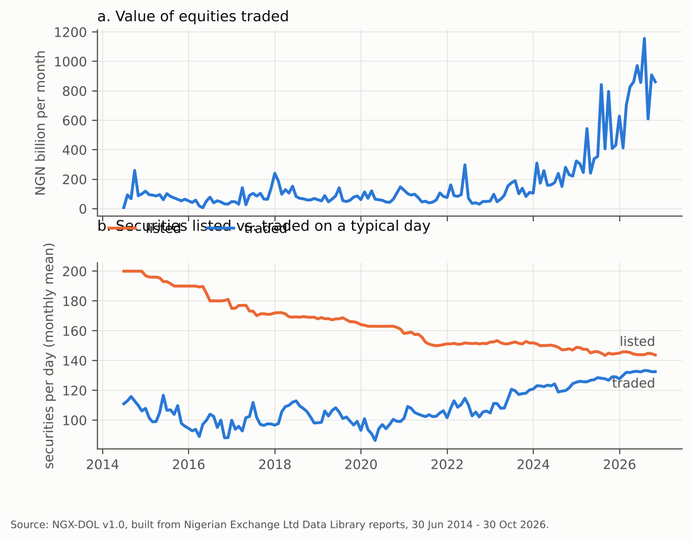
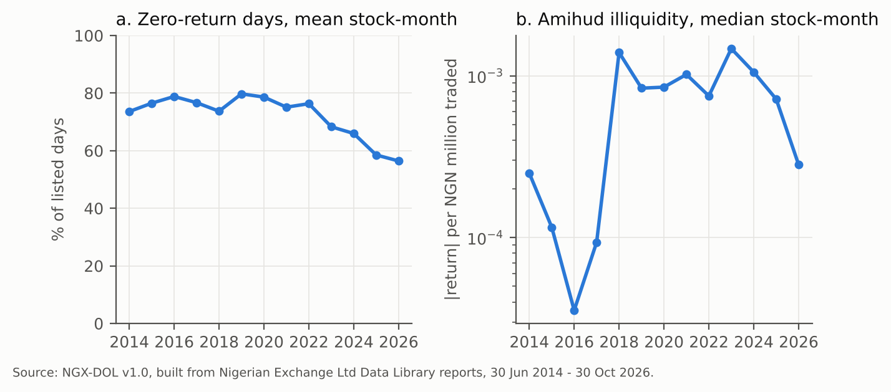
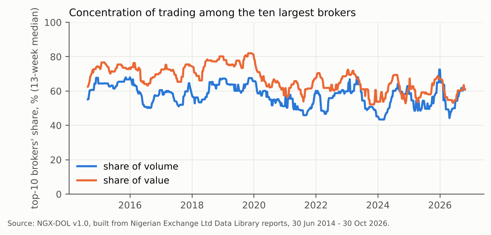

# Abstract

NGX-DOL turns twelve years of the Nigerian Exchange's official daily reports (June 2014 to October 2026) into an open, documented dataset covering 256 listed equities on 3,033 trading days. The code rebuilds the full daily table of prices and trades directly from NGX's public reports. Version 1.0 publishes monthly liquidity measures, daily market totals and weekly broker-concentration scores. Checked against a second NGX report, the trade counts and volumes match 100%.

The dataset contains 497,038 security-day observations parsed from 9,400 NGX Data Library reports, with board, sector, par value and, from 2016-03-16, exchange-reported market capitalisation, plus weekly top-10 broker tables for 571 weeks. Derived measures are Amihud illiquidity, turnover, zero-return days and broker concentration.

# Background and motivation

Nigeria is one of Africa's largest equity markets by listings, yet security-level historical data are available mainly through commercial vendors. Liquidity in such markets is commonly studied with low-frequency proxies such as the Amihud (2002) ratio and the zero-return proportion of Lesmond, Ogden and Trzcinka (1999), which require exactly this kind of daily security-level history. NGX publishes daily and weekly reports as PDF files in its public Data Library. They are complete and official, but not machine-readable at scale. NGX-DOL converts them into a harmonised panel with a published quality log.

# Data sources

NGX-DOL uses five report families from the NGX Data Library and one directory snapshot:

| Report | Files parsed | Content used |
|---|---|---|
| Gainers and Price list (daily) | 2919 | OHLC, deals, volume, value; per-security market cap |
| Daily Official List, Equities | 2928 | listed universe, board, sector, par, official price |
| Daily Summary | 2954 | independent trade record; market-cap fill |
| Weekly Summary Statistics | 598 | top-10 brokers by volume and value; weekly activity |
| Company directory (snapshot 2026-10-30) | 1 | ISIN, shares outstanding |

# Methods

Files are listed through the Data Library's public index and downloaded with a provenance log (file, size, SHA-256, URL, date). PDFs are converted to position-preserving text with poppler `pdftotext`. Rows are parsed with column-aware rules that cover the layout changes over the twelve years. The trade date is taken from inside each report, because some files are mis-titled. The panel is the union of securities on the Official List and securities traded on the price list. Days missing an Official List have their untraded universe imputed from adjacent days and flagged. Days missing a price list are flagged, with trading left unknown. ETFs, bonds and sukuk that appear in the same reports are excluded.

Derived measures follow standard definitions. Daily Amihud illiquidity is |r|/(value in NGN million), computed on traded days with positive value and |r| <= 11%. The zero-return indicator is 1 when the return is zero or the security did not trade. Turnover is volume over implied shares outstanding. Broker concentration is CR5, CR10 and the Herfindahl index of the published top-10 shares.

# Data records

The release (Zenodo, https://doi.org/10.5281/zenodo.23823011): Version 1.0 publishes the open parser and the derived measures only: a security-month liquidity panel (Amihud illiquidity, zero-return share, turnover, days traded), daily market totals, weekly broker-concentration indices (CR5, CR10, HHI of the top 10), and a securities reference table. The full security-day panel of prices and trades is not redistributed in v1.0; anyone can rebuild it from NGX's public reports with `run_all.sh`. A request to NGX for permission to redistribute the full panel is pending; if granted, it will be added as v1.1 under the same DOI. A codebook, quality report and SHA-256 checksums are included. Figure 1 summarises market activity.

# Technical validation

1. **Independent daily reconciliation.** For 42,798 security-days on which NGX's Daily Summary carries trade rows, deals agree in 100.0%, volume in 100.0% and value within NGN 1 in 99.54% of cases.
2. **Weekly reconciliation.** In the 443 weeks where every trading day has a complete price list, summed daily volumes equal NGX's weekly activity totals exactly for 97.89% of 57,384 security-weeks.
3. **Range checks.** No non-positive closes and no high-below-low rows. 74 returns exceed 11% in absolute value; these are flagged and excluded from Amihud.
4. **Coverage.** 3033 trading days, with three calendar gaps longer than five days.

Figure 2 shows the liquidity measures. The mean stock-month had zero returns on 76% of days in 2015 and 56% in 2026.

The median top-10 broker share is 67% of value and 58% of volume.

# Usage notes

Users should read the limitations file. In particular: per-security market cap begins in March 2016; ISINs cover currently listed issuers; symbol changes are not linked; and corporate actions are not adjusted.

# Code availability

Parser and build code (MIT): https://github.com/Osinoma/ngx-dol. Running `run_all.sh` reproduces every file and every number in this paper.

# Data availability and permissions

Derived from reports published by Nigerian Exchange Limited, which is the source and owner of the underlying data. NGX-DOL v1.0 does not redistribute NGX's security-level daily prices or broker tables; it publishes derived measures and market aggregates, and code that downloads the original reports directly from NGX. Raw NGX PDFs are not mirrored.

# Competing interests

The author designs and operates settlement and market-making architecture for the Nigerian equity market.

# AI assistance

Code and first-draft text were produced with AI assistance (Anthropic Claude). The author made all analytic decisions, verified the data against source reports, and takes responsibility for the content.

# References

Amihud, Y. (2002). Illiquidity and stock returns: cross-section and time-series effects. *Journal of Financial Markets*, 5(1), 31-56.

Lesmond, D. A., Ogden, J. P., & Trzcinka, C. A. (1999). A new estimate of transaction costs. *Review of Financial Studies*, 12(5), 1113-1141.

Nigerian Exchange Limited. Data Library. https://ngxgroup.com/exchange/data/data-library/ (accessed 30 October 2026).
